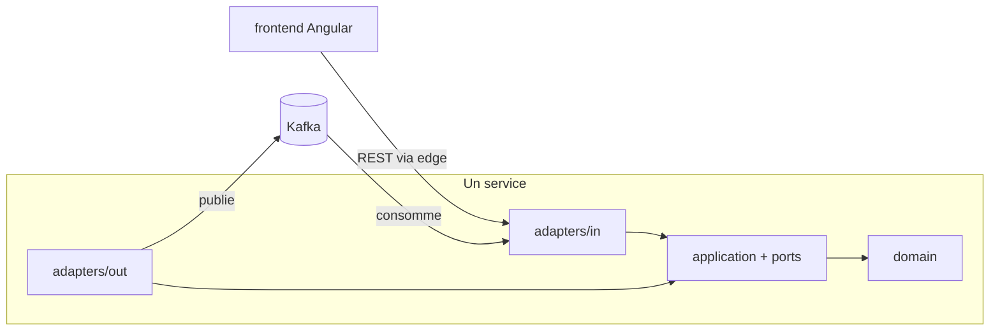
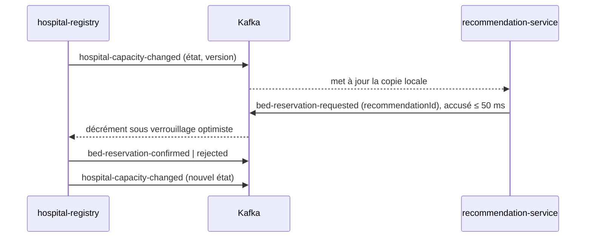
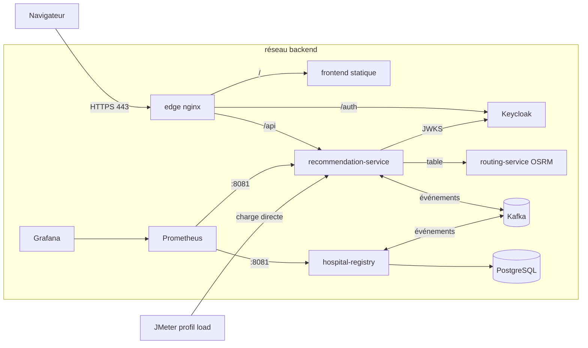
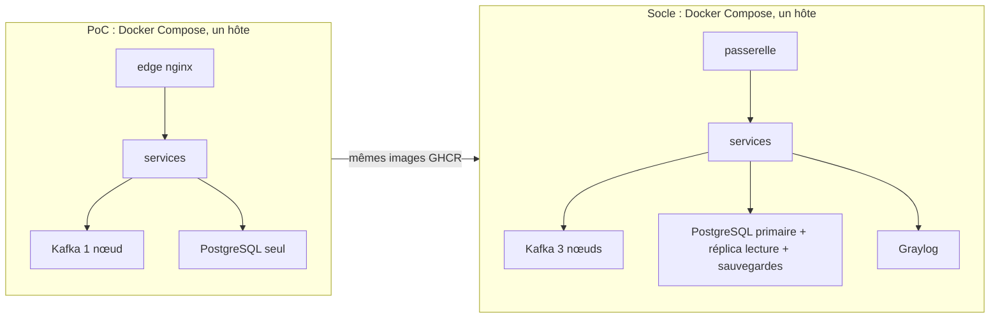

# Architecture Spine — Plateforme MedHead

`R<n>` renvoie à l'initiative parente, `poc-R<n>` à `initiative-meadhead-poc`.

## Design Paradigm

Microservices pilotés par les événements : chaque service possède ses données, publie ses faits métier sur Kafka et ne lit jamais le stockage d'un autre. À l'intérieur, chaque service Java suit l'architecture hexagonale.

| Couche hexagonale | Paquet | Dépend de |
| --- | --- | --- |
| Domaine (règles métier, sans framework) | `…/domain` | rien |
| Application (cas d'usage, ports) | `…/application` | domaine |
| Adaptateurs entrants (REST, consommateurs Kafka) | `…/adapters/in` | application |
| Adaptateurs sortants (Kafka, PostgreSQL, OSRM) | `…/adapters/out` | application (implémentent ses ports) |



## Invariants & Rules

### AD-1 — Découpage et propriété des données [ADOPTED]

- **Binds:** poc-R1, poc-R2, poc-R3, poc-R4, poc-R13 ; R4
- **Prevents:** deux écrivains des données hospitalières ; appels synchrones aux données d'hôpitaux dans le chemin critique.
- **Rule:** `hospital-registry` est le seul écrivain des hôpitaux, positions, spécialités et lits, et le seul producteur sur `medhead.hospitals.*` et sur les topics d'état et de résultat de `medhead.beds.*`. `recommendation-service` n'écrit aucune donnée hospitalière : il tient une copie locale alimentée par événements et publie des demandes de réservation. `routing-service` (OSRM) ne connaît pas les hôpitaux. Tout nouveau service possède son propre stockage.

### AD-2 — Direction des dépendances dans un service [ADOPTED]

- **Binds:** all services Java
- **Prevents:** logique métier couplée à Spring, Kafka ou OSRM ; tests du domaine impossibles sans infrastructure.
- **Rule:** `domain` n'importe aucun framework ; les adaptateurs dépendent des ports de `application`, jamais l'inverse ; aucune dépendance entre adaptateurs.

### AD-3 — Bus d'événements et topics [ADOPTED]

- **Binds:** poc-R2, poc-R13 ; R4, R5, R6
- **Prevents:** un second bus ; une copie locale impossible à reconstruire ; des topics créés avec des configurations divergentes.
- **Rule:** toute communication asynchrone passe par Apache Kafka en mode KRaft (un nœud en PoC, trois dans le socle). `auto.create.topics.enable=false` : chaque topic est déclaré une seule fois dans `infra/kafka/topics.yaml` (partitions, `cleanup.policy`, rétention) et créé par le service Compose `kafka-init` avant les services ; les tests Testcontainers lisent le même fichier ; aucun service ne crée de topic. Topics d'état : compactés, 6 partitions. Topics de réservation : suppression après 7 jours, 6 partitions. Le nombre de partitions d'un topic ne change jamais ; le changer impose un nouveau suffixe `.v<n>`.

### AD-4 — Forme des événements [ADOPTED]

- **Binds:** poc-R2, poc-R6, poc-R12 ; R6
- **Prevents:** formats incompatibles entre producteurs et consommateurs ; copie locale écrasée par un message en retard ; coordonnées conservées dans Kafka.
- **Rule:** JSON avec enveloppe CloudEvents 1.0 en mode binaire, en-têtes `ce_*` posés par l'adaptateur Kafka ; chaque type a un JSON Schema dans `contracts/events/`, validé par les tests des deux côtés ; champs en camelCase, mêmes noms que l'OpenAPI. Chaque topic d'état porte l'état complet de son agrégat, avec un champ `version` (entier 64 bits strictement croissant par hôpital et par topic, tiré d'une colonne de base, jamais d'une horloge) ; un consommateur garde une version par hôpital et par topic et ignore toute version inférieure ou égale ; une suppression est un tombstone sur les deux topics d'état. Les événements de réservation ne portent ni coordonnées ni donnée patient. Clé de partition : `hospitalId`. Consommateurs idempotents sur l'`id` CloudEvents.

| Topic | Contenu |
| --- | --- |
| `medhead.hospitals.hospital-profile-changed.v1` | `{hospitalId, version, name, latitude, longitude, specialties[]}` |
| `medhead.beds.hospital-capacity-changed.v1` | `{hospitalId, version, availableBeds}` |
| `medhead.beds.bed-reservation-requested.v1` | `{recommendationId, hospitalId, specialty, requestedAt}` |
| `medhead.beds.bed-reservation-confirmed.v1` | `{recommendationId, hospitalId, decidedAt}` |
| `medhead.beds.bed-reservation-rejected.v1` | `{recommendationId, hospitalId, reason, decidedAt}` |

### AD-5 — Cycle de réservation [ADOPTED]

- **Binds:** poc-R2, poc-R13, poc-R14
- **Prevents:** une recommandation qui modifie les lits ; deux services qui décident d'une réservation ; une recommandation renvoyée sans que l'on sache si la réservation a été demandée.
- **Rule:** une recommandation réussie publie `bed-reservation-requested` avec un `recommendationId` (UUID), par un producteur idempotent (`enable.idempotence=true`, `acks=all`) qui attend l'accusé au plus `MEDHEAD_RECOMMENDATION_SERVICE_PUBLISH_TIMEOUT` (50 ms par défaut) ; jamais d'envoi sans attente. Sans accusé dans ce délai, la recommandation est renvoyée avec `reservation: "not-requested"` et `medhead_reservation_publish_failures_total` est incrémenté ; sinon `reservation: "requested"`. `hospital-registry` consomme les demandes en groupe `hospital-registry`, décrémente sur le primaire sous verrouillage optimiste sans descendre sous zéro, enregistre l'`id` traité dans `processed_event` dans la même transaction, puis publie `bed-reservation-confirmed` ou `bed-reservation-rejected` et le nouvel état de capacité. Sans recommandation, aucun événement. La confirmation fait foi.



### AD-6 — Publication fiable depuis une base [ADOPTED]

- **Binds:** poc-R2 ; R4
- **Prevents:** base et bus divergents après une panne entre deux écritures ; doublons non détectables.
- **Rule:** un service qui possède une base publie par transactional outbox : l'événement, avec son `id` CloudEvents attribué à l'insertion, est écrit dans la table `outbox` dans la même transaction que la donnée, puis relayé vers Kafka dans l'ordre de séquence de l'outbox par un seul relais actif. Jamais d'envoi Kafka direct après un commit.

### AD-7 — Copie locale de la recommandation [ADOPTED]

- **Binds:** poc-R1, poc-R8, poc-R13
- **Prevents:** mémoire non bornée ; trafic servi par une instance à copie vide ou partielle.
- **Rule:** la copie locale est en mémoire et ne contient que l'état actuel nécessaire à la recommandation : ni historique, ni donnée patient. Tout cache, dont celui des distances, a une taille maximale et une éviction. Elle lit les topics d'état par assignation de toutes leurs partitions (`assign`, sans `group.id` ni offsets validés), depuis le plus ancien offset à chaque démarrage. L'instance est prête quand, pour chaque partition, la position a atteint l'offset de fin relevé au démarrage. Un hôpital n'est candidat qu'une fois son profil et sa capacité reçus. Métriques : `medhead_local_view_size_bytes` (alerte au-delà de 256 Mo) et `medhead_local_view_lag_records`.

### AD-8 — Distances routières [ADOPTED]

- **Binds:** poc-R3, poc-R8, poc-R13
- **Prevents:** distance à vol d'oiseau présentée comme routière ; dépendance à une API tierce ; mesure de charge faite sur le chemin dégradé.
- **Rule:** le domaine obtient les distances par le port `TravelDistancePort`, implémenté par un adaptateur OSRM (`routing-service`, extrait OpenStreetMap du Grand Londres). Algorithme : filtrer spécialité et lit disponible, garder les *k* plus proches à vol d'oiseau (5 par défaut, configurable), départager par un appel OSRM `table` avec `annotations=distance`. La boîte englobante de l'extrait est dans `contracts/fixtures/bbox.json` ; toute coordonnée factice y est tirée et une requête hors de la boîte est refusée (`location-out-of-area`). Délai OSRM : `MEDHEAD_RECOMMENDATION_SERVICE_ROUTING_TIMEOUT` (80 ms par défaut), avec disjoncteur. Une distance nulle exclut le candidat ; si OSRM échoue ou si toutes sont nulles, classement à vol d'oiseau avec coefficient et `degraded: true`. Les données OSRM prétraitées sont une image `ghcr.io/<owner>/medhead-osrm-data:<date-extrait>`, construite par un workflow manuel et utilisée telle quelle par Compose et Testcontainers.

### AD-9 — Règles de décision [ADOPTED]

- **Binds:** poc-R1, poc-R4, poc-R14
- **Prevents:** résultats différents selon l'implémentation pour un même état.
- **Rule:** l'hôpital retenu est le plus proche par la route parmi ceux qui offrent la spécialité et au moins un lit disponible ; à distance égale, le plus de lits disponibles, puis le nom par ordre alphabétique. Sans candidat, réponse Problem Details `no-hospital-available` avec motif et aucun événement. Une spécialité absente de `contracts/reference/specialties.json` est refusée (`unknown-specialty`).

### AD-10 — Identité et autorisation [ADOPTED]

- **Binds:** poc-R6 ; R3
- **Prevents:** deux mécanismes d'authentification ; un appel IAM par requête ; jetons rejetés selon l'endroit où ils ont été obtenus.
- **Rule:** Keycloak est l'unique fournisseur d'identité, realm `medhead` versionné sans secret dans `infra/keycloak/medhead-realm.json`, servi derrière le point d'entrée sous `/auth` avec `KC_HOSTNAME` public : `iss` vaut toujours l'URL publique. Chaque service vérifie `iss` contre l'URL publique, récupère les clés JWKS par l'URL interne et les met en cache, vérifie l'audience `medhead-api` et lit les rôles de realm (`realm_access.roles`) ; `emergency-dispatcher` est requis (401 sans jeton, 403 sans rôle). Clients : `medhead-frontend` (public, Authorization Code + PKCE S256) et `medhead-load-test` (`client_credentials`, profil `load` seulement, jeton valable 30 min). Keycloak ne partage jamais la base d'un service métier.

### AD-11 — Point d'entrée [ADOPTED]

- **Binds:** poc-R5, poc-R6 ; R2
- **Prevents:** un service, une sonde ou une métrique joignable de l'extérieur ; deux configurations de proxy ; une image front à reconstruire au passage à la passerelle.
- **Rule:** seul le conteneur `edge` publie un port (443, TLS). En PoC c'est un nginx configuré dans `infra/edge/` : `/` vers `frontend`, `/api/` vers `recommendation-service` sans réécriture de chemin, `/auth/` vers Keycloak. L'image `frontend` est un nginx non root qui sert uniquement les fichiers statiques en HTTP sur 8080. Chaque service sert ses chemins complets `/api/v1/…` ; Actuator écoute sur le port de gestion 8081, jamais routé par `edge`. Dans le socle, une passerelle dédiée remplace `edge` (routage, TLS, limitation de débit) sans toucher à `frontend`.

### AD-12 — Contrat REST [ADOPTED]

- **Binds:** poc-R1, poc-R4, poc-R5, poc-R12, poc-R14
- **Prevents:** divergence entre front et API ; coordonnées dans les journaux.
- **Rule:** `contracts/openapi/` est la source de vérité ; les interfaces serveur Spring et le client TypeScript Angular sont générés depuis lui par openapi-generator. La recommandation est `POST /api/v1/recommendations`, spécialité et coordonnées dans le corps ; les coordonnées n'apparaissent jamais dans une URL. La liste des spécialités est servie par `GET /api/v1/specialties` depuis `contracts/reference/specialties.json` (`[{code, group, label}]`). Erreurs au format RFC 9457 Problem Details.

### AD-13 — Stockage par service [ADOPTED]

- **Binds:** poc-R2 ; R4
- **Prevents:** base partagée entre services ; code impossible à brancher sur des réplicas ou à faire survivre à une bascule.
- **Rule:** PostgreSQL appartient à `hospital-registry` seul ; Flyway gère uniquement le schéma. Chemins de lecture et d'écriture séparés dans le code, configurés par `MEDHEAD_HOSPITAL_REGISTRY_DB_WRITE_URL` et `MEDHEAD_HOSPITAL_REGISTRY_DB_READ_URL` (noms stables, valables après bascule) ; le cycle de réservation lit et écrit toujours sur le primaire.

### AD-14 — Images, configuration et secrets [ADOPTED]

- **Binds:** poc-R9, poc-R12 ; R6
- **Prevents:** images différentes selon l'environnement ; secrets dans le dépôt ou les images ; migration future vers un orchestrateur qui toucherait au code.
- **Rule:** une image par service, identique dans tous les environnements, configurée uniquement par variables d'environnement, exécutée sans root, sans secret embarqué. Sondes `/actuator/health/liveness` et `/actuator/health/readiness`. Secrets dans `.env` en local et dans les secrets GitHub Actions en CI ; aucun secret versionné ; le certificat TLS de développement est généré par script. La CI publie les images dans GHCR sur `develop` et `main`, étiquetées version et `sha-<court>`, et ne déploie rien. Environnements : `local`, `ci` (Compose dans GitHub Actions avec les images du même run), profil `load`.

### AD-15 — Observabilité [ADOPTED]

- **Binds:** poc-R6, poc-R15 ; R5
- **Prevents:** journaux non agrégeables ; métriques incomparables entre services ; donnée patient ou coordonnées dans les journaux et les traces.
- **Rule:** journaux au format structuré ECS de Spring Boot sur la sortie standard (`service.name`, `log.level`, `@timestamp`, `trace.id`), aucun fichier de journal dans un conteneur ; ni donnée patient ni coordonnées dans les journaux ou les attributs de trace. `trace.id` propagé par Micrometer Tracing (OpenTelemetry), export OTLP désactivé en PoC. Chaque service expose `/actuator/prometheus` sur le port 8081 ; latence HTTP en histogramme avec un seuil à 200 ms ; métriques métier préfixées `medhead_` avec l'étiquette `service`, l'étiquette `instance` restant celle de Prometheus. Règles d'alerte, tableaux de bord et sources Grafana sont versionnés dans `infra/` et provisionnés au démarrage. Dans le socle, les journaux partent vers Graylog par le pilote de journalisation Docker `gelf`.

### AD-16 — Protocole de mesure de charge [ADOPTED]

- **Binds:** poc-R8, poc-R15
- **Prevents:** une mesure qui ne vaut ni pour la production ni pour une seule instance.
- **Rule:** JMeter, hors CI, cible une seule instance de `recommendation-service` aux limites CPU et mémoire fixées, directement sur le réseau `backend`, avec les jeux `scenario` et `load-2000` chargés et la remise des lits active ; jeton `medhead-load-test` obtenu en début de campagne. Une mesure via `edge` peut compléter le reporting.

### AD-17 — Pyramide de tests [ADOPTED]

- **Binds:** poc-R7, poc-R9
- **Prevents:** niveaux de test redondants ou manquants selon l'epic ; tests qui échouent selon l'ordre d'exécution.
- **Rule:** domaine testé sans Spring ni Kafka (JUnit Jupiter, Vitest côté Angular) ; critères métier en scénarios Cucumber-JVM rédigés en français ; adaptateurs testés avec Testcontainers sur de vrais Kafka, PostgreSQL, Keycloak et OSRM ; événements validés contre leur JSON Schema et API contre l'OpenAPI ; parcours de bout en bout avec Playwright. Les scénarios BDD et E2E rechargent le jeu `scenario` avant chaque scénario qui consomme un lit. Le pipeline tourne sur chaque push et pull request et publie les rapports de chaque niveau.

### AD-18 — Données factices et amorçage [ADOPTED]

- **Binds:** poc-R1, poc-R7, poc-R8 ; R4
- **Prevents:** hôpitaux inconnus du registre ; copie locale vide malgré une base remplie ; lits épuisés pendant un test.
- **Rule:** tout hôpital, y compris factice, entre par le port `HospitalImportPort` de `hospital-registry`, qui écrit l'hôpital et sa ligne d'outbox dans la même transaction. Les jeux sont versionnés dans `contracts/fixtures/` (`scenario.json` : les trois hôpitaux du scénario ; `load-2000.json` : produit par le générateur de `tests/load/` avec une graine fixe), sans `hospitalId` : le registre le dérive de façon déterministe d'un code métier. Jeux chargés au démarrage selon `MEDHEAD_HOSPITAL_REGISTRY_FIXTURES`. En profils `load` et `test`, `MEDHEAD_HOSPITAL_REGISTRY_BED_REPLENISH=true` remet la capacité initiale après chaque confirmation. La copie locale n'est jamais modifiée hors des événements reçus.

## Consistency Conventions

| Concern | Convention |
| --- | --- |
| Noms de services | kebab-case : `recommendation-service`, `hospital-registry`, `routing-service`, `edge`, `frontend`, `kafka-init` |
| CloudEvents | `type` = nom du topic ; `source` = `/services/<service>` ; noms au passé ou en `…-requested` |
| Identifiants | `hospitalId` et `recommendationId` en UUID |
| Coordonnées et unités | WGS84 degrés décimaux, champs `latitude` et `longitude` ; distances en mètres, durées en secondes |
| Dates | ISO-8601 UTC partout |
| Erreurs REST | RFC 9457, `type` = `urn:medhead:problem:<code>` : `no-hospital-available`, `unknown-specialty`, `location-out-of-area` |
| Versionnage | `/api/v1` ; suffixe `.v<n>` des topics ; nouvelle version à chaque changement incompatible |
| Configuration | variables `MEDHEAD_<SERVICE>_<CLÉ>` ; `.env` non versionné, `.env.example` versionné |
| Compose | réseaux `edge` et `backend` ; profils `app`, `observability`, `load` ; `healthcheck` sur readiness et `depends_on: condition: service_healthy` ; Kafka, PostgreSQL, OSRM, Keycloak exposés seulement par une surcharge de développement |
| Images | multi-stage, base `eclipse-temurin:25-jre`, utilisateur non root ; jamais `latest` hors poste local |
| Alertes | p95 > 200 ms sur 1 min ; erreurs > 1 % ; readiness en échec ; copie locale > 256 Mo ; retard de la copie locale ; échecs de publication de réservation |
| Documentation | Javadoc sur les ports et les API publiques ; Markdown pour le projet ; une section du readme par epic ; reporting dans le dépôt d'architecture séparé |
| Git | Gitflow : `main`, `develop`, branches préfixées issues de `develop` |

## Stack

| Name | Version |
| --- | --- |
| Java | 25 (LTS) |
| Spring Boot | 4.1.x, jusqu'au premier correctif de 4.2 |
| JUnit Jupiter | 6.x, géré par Spring Boot |
| openapi-generator | ≥ 7.16 (`useSpringBoot4`, `useJackson3`, `typescript-angular`) |
| Angular | 22.x |
| Apache Kafka (KRaft) | 4.4.0 |
| Keycloak | 26.8.2 |
| PostgreSQL | 18.x |
| OSRM (`ghcr.io/project-osrm/osrm-backend`) | 26.x |
| Prometheus | 3.13 (LTS) |
| Grafana | 13.x |
| Graylog (socle, avec MongoDB et Data Node) | 7.1.x |
| JMeter | 5.6.3, sur JRE 21 |
| CloudEvents | 1.0 |

## Structural Seed





```text
meadhead/
  services/
    recommendation-service/   # domain/ application/ adapters/{in,out}/
    hospital-registry/
  frontend/                   # Angular, image statique
  contracts/
    openapi/                  # contrats REST, source de vérité
    events/                   # JSON Schema des événements
    reference/                # specialties.json
    fixtures/                 # scenario.json, load-2000.json, bbox.json
  infra/                      # compose, edge, kafka/topics.yaml, keycloak, prometheus, grafana, osrm
  tests/
    e2e/                      # Playwright
    load/                     # plans JMeter, générateur de load-2000
```

## Capability → Architecture Map

| Capability / Area | Lives in | Governed by |
| --- | --- | --- |
| poc-R1 recommandation | `recommendation-service` domain | AD-1, AD-7, AD-8, AD-9 |
| poc-R2 événement de réservation | `recommendation-service`, `hospital-registry` | AD-4, AD-5, AD-6 |
| poc-R3 distance routière | `TravelDistancePort` + `routing-service` | AD-8 |
| poc-R4 spécialités NHS | `contracts/reference/`, `GET /api/v1/specialties` | AD-9, AD-12 |
| poc-R5 page unique | `frontend/` derrière `edge` | AD-11, AD-12 |
| poc-R6 protection, authentification, RGPD | Keycloak, chaque service, événements | AD-4, AD-10, AD-11, AD-15 |
| poc-R7 pyramide de tests | tous | AD-17, AD-18 |
| poc-R8 charge 200 ms / 800 req/s | `recommendation-service`, `tests/load/` | AD-7, AD-16, AD-18 |
| poc-R9 CI/CD | `.github/workflows/` | AD-14, AD-17 |
| poc-R10 readme | racine du dépôt | Conventions |
| poc-R11 reporting | dépôt d'architecture séparé | AD-15, AD-16 |
| poc-R12 bloc de construction | `contracts/`, images | AD-4, AD-12, AD-14 |
| poc-R13 panne d'un service | `recommendation-service` | AD-3, AD-5, AD-7, AD-8 |
| poc-R14 aucun hôpital, égalité | `recommendation-service` domain | AD-5, AD-9 |
| poc-R15 supervision de performance | `infra/` Prometheus, Grafana | AD-15 |
| R2 passerelle | socle | AD-11 |
| R3 IAM et rôles | Keycloak | AD-10 |
| R4 base redondante | `hospital-registry` | AD-6, AD-13, AD-18 |
| R5 Grafana et Graylog | `infra/` | AD-15 |
| R6 modèle d'ajout de service | tous | AD-1, AD-2, AD-3, AD-4, AD-14 |

## Deferred

- Kubernetes (opérateurs CloudNativePG, Strimzi, Keycloak) et déploiement continu GitOps (Argo CD, environnement de recette, hébergeur) — écartés pour l'instant ; à revisiter quand la PoC est validée ou quand la perte d'un hôte doit être démontrée.
- Haute disponibilité au niveau hôte — dépend du point précédent ; avec Compose, la redondance se démontre au niveau conteneur.
- Produit de passerelle du socle (Spring Cloud Gateway, Traefik…) — choisi dans le socle ; AD-11 fixe déjà son rôle.
- Outils de réplication, sauvegarde et bascule PostgreSQL (streaming replication, pgBackRest ou WAL-G, Patroni) — choisis dans le socle ; AD-13 rend le code prêt.
- Registre de schémas et Debezium — quand plusieurs équipes produiront des événements.
- SIEM complet (règles de détection, corrélation) — avec des données réelles et une équipe sécurité.
- Plateforme de visualisation des traces (Tempo, Jaeger) — dans le socle ; `trace.id` est déjà propagé.
- Granularité des lits par spécialité — le scénario raisonne par hôpital ; future initiative.
- Fraîcheur de la capacité quand `hospital-registry` est longtemps indisponible — à traiter par un horodatage de fraîcheur si le besoin apparaît.
- Découpage régional ou stockage embarqué de la copie locale (RocksDB, Redis) — si `medhead_local_view_size_bytes` dépasse son seuil ; dimensionnement national estimé à quelques dizaines de Mo.
- Passage à PostgreSQL 19 et à Spring Boot 4.2 — après leurs premiers correctifs.
- Versions exactes de Cucumber-JVM, Testcontainers, Playwright, nginx et Flyway, et tag OSRM — épinglées dans `epic-socle-plateforme` de la PoC après vérification des pages de releases.
