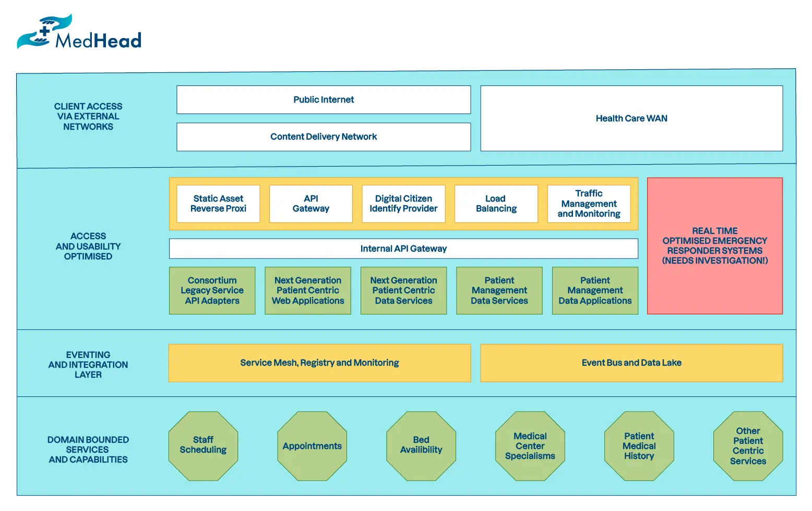

# Déclaration des travaux d’architecture

Projet : Preuve de concept (l'allocation de lits d'hôpital pour les urgences)

Client : Consortium MedHead

---

## Table des matières

- **Demande de projet et contexte** — 2
  - Demande spécifique — 2
  - Alignement stratégique — 2
  - Simplifications suggérées — 4
- **Approche architecturale** — 4
  - Processus d'architecture — 4
  - Contenu de l'architecture — 6
- **Méthodologies pertinentes et normes du secteur** — 7
- **Prise en charge du continuum des entreprises et des solutions** — 8
- **Livrables de travail** — 8
- **Critères et procédures d'acceptation** — 8
- **Approbation** — 8

---

## Demande de projet et contexte

### Demande spécifique

En fonction des risques identifiés pour le projet, le comité d’architecture a demandé une preuve de concept dont le but est d’évaluer la capacité du comité d’architecture à répondre aux besoins dans le cadre du système d’intervention d’urgence en temps réel.

### Alignement stratégique

Un prototype sera construit en vue de réduire le risque pour le système d'intervention d'urgence de l'architecture globale cible (MedHead) :

*Description du schéma d'architecture globale cible MedHead (libellés d'origine conservés) :*

| Couche | Composants |
|---|---|
| **CLIENT ACCESS VIA EXTERNAL NETWORKS** | Public Internet ; Content Delivery Network ; Health Care WAN |
| **ACCESS AND USABILITY OPTIMISED** | *Bloc jaune :* Static Asset Reverse Proxi ; API Gateway ; Digital Citizen Identify Provider ; Load Balancing ; Traffic Management and Monitoring *Barre :* Internal API Gateway *Bloc vert :* Consortium Legacy Service API Adapters ; Next Generation Patient Centric Web Applications ; Next Generation Patient Centric Data Services ; Patient Management Data Services ; Patient Management Data Applications *Bloc rouge (à droite) :* REAL TIME OPTIMISED EMERGENCY RESPONDER SYSTEMS (NEEDS INVESTIGATION!) |
| **EVENTING AND INTEGRATION LAYER** | Service Mesh, Registry and Monitoring ; Event Bus and Data Lake |
| **DOMAIN BOUNDED SERVICES AND CAPABILITIES** | Staff Scheduling ; Appointments ; Bed Availibility ; Medical Center Specialisms ; Patient Medical History ; Other Patient Centric Services |

### Simplifications suggérées

La preuve de concept peut restreindre sa portée en se concentrant principalement sur la réponse aux préoccupations énoncées dans le document des exigences de la PoC. Voici des exemples de simplifications potentielles :

- Utiliser uniquement des interfaces tampons ou des implémentations factices de systèmes auxiliaires ;
- Faire des hypothèses simplifiées sur les contrats de ces systèmes en aval ;
- Documenter les lacunes d'un prototype et un plan pour y remédier dans tout système résultant.

---

## Approche architecturale

### Processus d'architecture

La méthode de développement de l'architecture TOGAF (ADM) définit les meilleures pratiques pour le développement de l'architecture. Cependant, toutes les phases ne sont pas nécessairement pertinentes pour chaque projet. Le tableau ci-dessous décrit l'utilisation de l'ADM pour ce projet particulier.

| Phase | Entrée/Sortie | Remarques |
|---|---|---|
| **Préliminaire** | Énoncé des travaux d’architecture | |
| **A - Vision de l'architecture** | Énoncé des travaux d’architecture Principes d’architectures Document de définition de l’architecture Document des exigences pour le développement de la preuve de concept | La vision est consolidée dans les objectifs du document de définition de l'architecture et du document des exigences de la PoC |
| **B - Architecture métier** | Données de références pour les spécialités NHS Document de définition de l’architecture Document des exigences pour le développement de la preuve de concept | En parallèle avec C et D : Opère dans le domaine des interventions d'urgence et de l'attribution de lits |
| **C - Architecture des systèmes d'information** | Document de définition de l’architecture Document des exigences pour le développement de la preuve de concept | En parallèle avec B et D : Opère dans le domaine des interventions d'urgence et de l'attribution de lits, vise à adhérer aux Principes d’architecture appropriés |
| **D - Architecture technologique** | Document de définition de l’architecture Document des exigences pour le développement de la preuve de concept | En parallèle avec B et C |
| **E - Opportunités et solutions** | Bloc de construction de la solution (SBB) | Définition des SBB permettant la mise en oeuvre de la preuve de concept |
| **F - Planification de la migration** | Feuille de route Documentation de la mise en œuvre d’un pipeline de déploiement | Focus sur l’écart entre la PoC et son adaptation en production Mise en œuvre d’une réponse aux considérations de construction d’un pipeline de déploiement CI/CD. |
| **G - Gouvernance de la mise en œuvre** | Évaluation de la conformité | Démonstration de la conformité de la preuve de concept avec les principes architecturaux métiers et techniques et avec les exigences formalisées de la preuve de concept. |
| **H - Gestion du changement d'architecture** | | Les mises à jour d'architecture sont autorisées et doivent être documentées par le biais d'un historique d'approbation des modifications des composants architecturaux et autres artéfacts. |

Ce premier cycle établira une base de référence pour l'approche utilisée avec les preuves de concept. Les enseignements peuvent être partagés par le biais de la documentation produite.

### Contenu de l'architecture

Le cadre ACF (Architecture Content Framework) TOGAF fournit une catégorisation des meilleures pratiques du contenu de l'architecture. Cependant, tous les éléments ne sont pas également pertinents pour chaque projet. Le tableau ci-dessous décrit les domaines de contenu pertinents pour ce projet particulier.

| Zone de contenu | Remarques |
|---|---|
| **Principes, vision et exigences de l'architecture** | Définit à travers les Principes d'architecture, le Document de définition de l'architecture et les exigences pour le développement de la preuve de concept. |
| **Architecture métier** | Voir le modèle du domaine de haut niveau dans le Document de définition de l'architecture |
| **Architecture des systèmes d'information - Données** | Mettez à jour cet énoncé des travaux si nécessaire. Voir le Document de définition de l'architecture. Le comité d'architecture recommande une approche basée sur les données. |
| **Architecture des systèmes d'information - Applications** | Mettez à jour cet énoncé des travaux si nécessaire. Voir le Document de définition de l'architecture et le document des exigences de la preuve de concept. |
| **Architecture technologique** | Mettez à jour cet énoncé des travaux si nécessaire. Voir le Document de définition de l'architecture et le document des exigences de la preuve de concept. Une modélisation de l’architecture technologique de la preuve de concept mériterait d’être ajoutée. |
| **Réalisation de l'architecture** | Projet logiciel complet avec l’interface et l’API fonctionnelle, éprouvée en utilisant de solides principes d'ingénierie et de test. Documentation du code/projet fournie dans le répertoire. |

Les préoccupations des principales parties prenantes doivent être prises en compte et être prioritaires, en particulier en ce qui concerne les temps de réponse, l'évolutivité, la tolérance aux pannes des systèmes hospitaliers auxiliaires et la résilience sous charge.

---

## Méthodologies pertinentes et normes du secteur

Voir le document Principes d'architecture pour les principes spécifiques pour les preuves de concepts.

---

## Prise en charge du continuum des entreprises et des solutions

Dans la mesure du possible, la PoC devrait fournir ou faciliter la création de modules de construction (Solution Building Blocks) pour l'architecture et la solution.

Plus précisément, nous souhaitons que la PoC fournisse :

- une stratégie de test pour la validation de principe ;
- la réalisation d'un pipeline CI/CD (même rudimentaire) qui pourra être utilisée pour d'autres projets.

---

## Livrables de travail

- Une implémentation, des tests et la documentation associée ;
- Les rapports d'exécution des tests produits pendant l'intégration continue afin de démontrer les comportements livrés ;
- Une présentation de la PoC, détaillant le comportement pris en charge, les connaissances acquises et les recommandations futures.

---

## Critères et procédures d'acceptation

Ils seront définis ultérieurement de manière appropriée en ligne avec les principes d'architecture, le document définissant les exigences pour le développement de la preuve de concept et le résultat d’une preuve de concept

---

## Approbation

Kara Trace, membre du conseil d'administration de MedHead et du comité d’architecture
